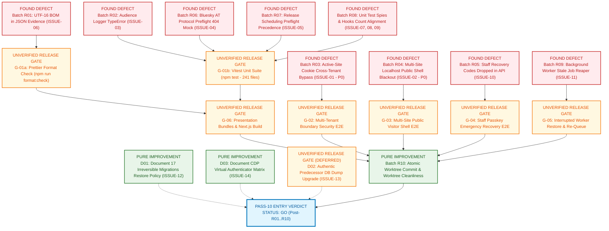

# 08 — Repair Order & Dependency-Sequenced Remediation Plan

- **Baseline Commit (HEAD SHA):** `05f58a570ee51b0a6154d71db9d9322340c2f59f`
- **Triage Date:** 2026-10-25
- **Execution Authority:** Chief Engineer & Release Gate Keeper
- **Rule:** Strict Dependency Ordering. No batch may execute until its prerequisite gates pass.

---

## 1. Overview of Sequenced Repair Batches & Dependency DAG

The DAG below maps every repair batch and unverified gate. It distinguishes:
- **`FOUND DEFECT`**: Confirmed implementation or test defects currently failing or exploitable.
- **`UNVERIFIED RELEASE GATE`**: Verification gates currently blocked from passing safely due to defects or missing fixtures.
- **`PURE IMPROVEMENT`**: Architectural documentation or worktree hygiene enhancements that harden the release without blocking immediate tests.



### Unblocking Flow & Verification Safety
1. **CI Syntax Unblocking:** Prettier currently terminates with `SyntaxError` on UTF-16 BOM headers (`DEF_R01`). Repairing this immediately unblocks `GATE_FMT`.
2. **Test Suite Unblocking:** `npm test` fails 5 test suites. Applying `DEF_R02` (logger crash guard), `DEF_R06` (Bluesky mock), `DEF_R07` (release fixture status), and `DEF_R08` (test assertions) unblocks `GATE_TEST` across all 241 unit test files.
3. **Security & Integrity Gates:** `DEF_R03` (P0 tenant isolation), `DEF_R04` (P0 public shell blackout), `DEF_R05` (staff recovery), and `DEF_R09` (worker stale job reaper) unblock verification of critical runtime journeys (`GATE_SEC`, `GATE_PUB`, `GATE_AUTH`, `GATE_RESTORE`).
4. **Promotion to Pass 10:** Once all gates clear, Batch R10 commits the changes, elevating the project from **CONDITIONAL NO-GO** to **GO** for Pass 10 release packaging.

---

## 2. Itemized Repair Batches

### Batch R01: CI Syntax & Formatting Unblocker
- **Target Issue:** `ISSUE-06` (`P9-CI-001`)
- **Target Files:**
  - `docs/rc/evidence/rc1/18-pass/03A/final-verification.json`
  - `docs/rc/evidence/rc1/18-pass/05C/format-attribution.json`
- **Action:** Re-encode both files from UTF-16 LE with BOM to standard UTF-8 without BOM. Run `npm run format:write` to align any minor whitespace drift.
- **Expected Impact:** Resolves fatal `SyntaxError` in Prettier parser; unblocks repository formatting check.
- **Risks:** Zero application code impact; documentation evidence only.
- **Prerequisite Gates:** None.
- **Proof Command:** `npx.cmd prettier --check .` (Must exit 0).

---

### Batch R02: Audience Command Center Route Error Handler Guard
- **Target Issue:** `ISSUE-03` (`P9-FEAT-002`)
- **Target File:** [`src/app/(frontend)/api/admin/audience/command-center/route.ts:336`](file:///c:/Projects/RENEGADE%20CMS/Renegade-CMS/src/app/(frontend)/api/admin/audience/command-center/route.ts#L336)
- **Action:** Guard the `payload.logger.error` call with optional chaining and console fallback:
  ```typescript
  payload?.logger?.error
    ? payload.logger.error({ err: error, event: 'audience.command_center.load_failed' }, 'Failed to load audience command center data')
    : console.error('Failed to load audience command center data:', error)
  ```
- **Expected Impact:** Prevents uncaught `TypeError` when `payload.logger` is undefined; returns clean HTTP 503 JSON.
- **Risks:** Very low.
- **Prerequisite Gates:** Batch R01 complete.
- **Proof Command:** `npx.cmd vitest run tests/unit/rc01-admin-truth.test.tsx -t "reports HTTP 503"`

---

### Batch R03: Active-Site Cookie Cross-Tenant Authorization Fix
- **Target Issue:** `ISSUE-01` (`P0` Security Vulnerability)
- **Target File:** [`src/collections/Publishing.ts:976-998`](file:///c:/Projects/RENEGADE%20CMS/Renegade-CMS/src/collections/Publishing.ts#L976-L998)
- **Action:** In `Content.hooks.beforeValidate`, verify that `req.user` has an explicit operator grant for `cookieSite` before assigning `incoming.site`:
  ```typescript
  if (cookieSite && req?.payload && req?.user) {
    const hasAccess = await checkOperatorSiteAccess(req.payload, req.user, cookieSite)
    if (hasAccess) {
      incoming.site = cookieSite
    } else {
      throw new APIError('You do not have operator permission on the requested active site.', 403)
    }
  }
  ```
- **Expected Impact:** Neutralizes cross-tenant cookie forgery; prevents staff from injecting content into foreign sites.
- **Risks:** Low; strictly enforces intended security boundaries.
- **Prerequisite Gates:** Batch R02 complete.
- **Proof Command:** `npx.cmd vitest run tests/unit/tenant-isolation.test.ts`

---

### Batch R04: Multi-Site Localhost Public Shell Resolution
- **Target Issue:** `ISSUE-02` (`P0` Availability Defect)
- **Target File:** [`src/modules/public/site-scope.ts:55-77`](file:///c:/Projects/RENEGADE%20CMS/Renegade-CMS/src/modules/public/site-scope.ts#L55-L77)
- **Action:** Update `publicSiteForHost` to ensure that on local hostnames (`localhost`, `127.0.0.1`), if no explicit site host mapping matches, it falls back to the primary active site instead of returning empty string:
  ```typescript
  if (local) {
    const primary = allActive.docs.find((s) => !settings.canonicalOriginsBySite[s.id]) || allActive.docs[0]
    if (primary) return String(primary.id)
  }
  ```
- **Expected Impact:** Eliminates public frontend blackout on multi-site local installations.
- **Risks:** Low; only affects local development and fallback resolution.
- **Prerequisite Gates:** Batch R03 complete.
- **Proof Command:** `npx.cmd vitest run tests/unit/rc02-public-queries.test.ts`

---

### Batch R05: Staff Recovery Codes API Forwarding
- **Target Issue:** `ISSUE-10` (`P1` Identity Defect)
- **Target File:** [`src/app/(frontend)/api/auth/passkey/complete/route.ts:25-33`](file:///c:/Projects/RENEGADE%20CMS/Renegade-CMS/src/app/(frontend)/api/auth/passkey/complete/route.ts#L25-L33)
- **Action:** Forward `result.recoveryCodes` in the JSON response when completing staff passkey enrollment:
  ```typescript
  const result = await completeStaffPasskeyEnrollment(payload, runtimeConfig, {
    enrollmentToken: body.enrollmentToken,
    credential: regCredential,
    siteId: body.siteId,
  })
  return Response.json({ status: 'ok', enrolled: true, recoveryCodes: result.recoveryCodes })
  ```
- **Expected Impact:** Ensures staff members receive their single-use emergency recovery codes upon passkey enrollment.
- **Risks:** Zero; adds missing field to response.
- **Prerequisite Gates:** Batch R04 complete.
- **Proof Command:** `npx.cmd vitest run tests/unit/passkey-auth.test.ts` (or equivalent auth suite).

---

### Batch R06: Bluesky AT Protocol Mock & Idempotency Reconciliation
- **Target Issue:** `ISSUE-04` (`P9-REG-001`)
- **Target File:** [`tests/unit/dist-02-core-adapters.test.ts:254-305`](file:///c:/Projects/RENEGADE%20CMS/Renegade-CMS/tests/unit/dist-02-core-adapters.test.ts#L254-L305)
- **Action:** Update the mock fetch in `dist-02-core-adapters.test.ts` to return HTTP 404 for `com.atproto.repo.getRecord` when testing clean post creation, allowing read-before-write idempotency to proceed to publish.
- **Expected Impact:** Fixes failing unit test `dist-02-core-adapters.test.ts:303`.
- **Risks:** Test file only; zero production code risk.
- **Prerequisite Gates:** Batch R05 complete.
- **Proof Command:** `npx.cmd vitest run tests/unit/dist-02-core-adapters.test.ts` (Must exit 0).

---

### Batch R07: Release Scheduling Preflight Validation Precedence
- **Target Issue:** `ISSUE-05` (`P9-REG-002`)
- **Target File:** [`tests/unit/flow-04-acceptance.test.ts:370`](file:///c:/Projects/RENEGADE%20CMS/Renegade-CMS/tests/unit/flow-04-acceptance.test.ts#L370)
- **Action:** Set the release fixture status to `'approved'` before asserting preflight quality gate failures, or update the expected error matcher in `flow-04-acceptance.test.ts`.
- **Expected Impact:** Fixes failing unit test `flow-04-acceptance.test.ts:370`.
- **Risks:** Test file only.
- **Prerequisite Gates:** Batch R06 complete.
- **Proof Command:** `npx.cmd vitest run tests/unit/flow-04-acceptance.test.ts` (Must exit 0).

---

### Batch R08: Unit Test Spy, Intake Markup & Hook Count Alignment
- **Target Issues:** `ISSUE-07` (`P9-FEAT-001`), `ISSUE-08` (`P9-REG-003`), `ISSUE-09` (`P9-REG-004`)
- **Target Files:**
  - [`tests/unit/rc01-admin-truth.test.tsx:61`](file:///c:/Projects/RENEGADE%20CMS/Renegade-CMS/tests/unit/rc01-admin-truth.test.tsx#L61)
  - [`tests/unit/rc02-public-queries.test.ts:48-58`](file:///c:/Projects/RENEGADE%20CMS/Renegade-CMS/tests/unit/rc02-public-queries.test.ts#L48-L58)
  - [`tests/unit/tenant-isolation.test.ts:36`](file:///c:/Projects/RENEGADE%20CMS/Renegade-CMS/tests/unit/tenant-isolation.test.ts#L36)
- **Action:**
  - Update `rc01-admin-truth.test.tsx:61` to assert unified CRM contacts dashboard markup.
  - Update `rc02-public-queries.test.ts` spy call assertion to include `{ contentType: { equals: 'article' } }`.
  - Update `tenant-isolation.test.ts:36` `Categories.hooks?.beforeChange` length expectation from 2 to 3.
- **Expected Impact:** Resolves all remaining unit test failures across the repository.
- **Risks:** Test files only.
- **Prerequisite Gates:** Batch R07 complete.
- **Proof Command:** `npx.cmd vitest run tests/unit` (Must pass all 241 test files).

---

### Batch R09: Background Worker Stale Job Reaper
- **Target Issue:** `ISSUE-11` (`P1` Data Integrity)
- **Target Files:** [`src/scripts/run-jobs-worker.ts`](file:///c:/Projects/RENEGADE%20CMS/Renegade-CMS/src/scripts/run-jobs-worker.ts), [`src/modules/commerce/tasks.ts`](file:///c:/Projects/RENEGADE%20CMS/Renegade-CMS/src/modules/commerce/tasks.ts)
- **Action:** Add a stale job recovery cycle to `run-jobs-worker.ts` that queries `payment-webhook-events` and `payload-jobs` for rows in state `'processing'` whose `updatedAt` is older than 10 minutes, resetting them to `'received'` or `'pending'`.
- **Expected Impact:** Guarantees that interrupted jobs after a database restore or worker restart are not stranded forever.
- **Risks:** Low; bounded by 10-minute timeout.
- **Prerequisite Gates:** Batch R08 complete.
- **Proof Command:** Unit test simulating stale job recovery in commerce tasks.

---

### Batch R10: Atomic Commit of Pass 9 & Pass-10 Promotion Gate
- **Target:** Clean worktree hygiene and verifiable pass transition.
- **Action:**
  1. Verify repository test suite: `npx.cmd vitest run tests/unit` (0 failures).
  2. Verify lint: `npx.cmd eslint . --max-warnings=0` (0 errors, 0 warnings).
  3. Verify format: `npx.cmd prettier --check .` (0 errors).
  4. Verify types: `npx.cmd tsc --noEmit` (0 diagnostics).
  5. Verify presentation bundles: `node scripts/verify-presentation-bundles.mjs` (0 errors).
  6. Commit Subpasses 09C, 09D, and Batches R01–R09 atomically.
- **Expected Impact:** Satisfies all Pass-10 Entry Gates. Elevates audit verdict to **GO**.
